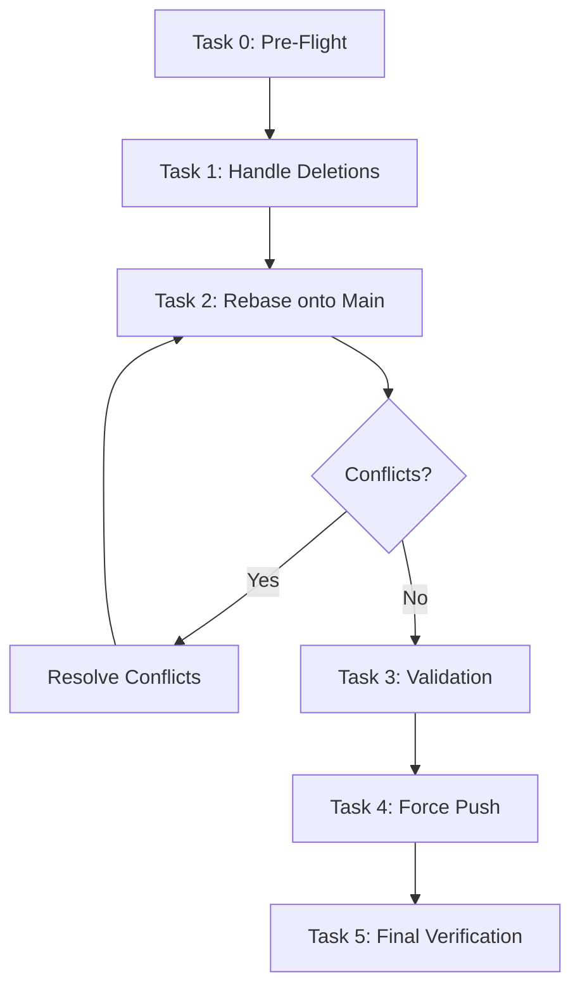

# Plan: Update Local Repository to Latest GitHub Version

> **Context Check (Phase -1):** This plan addresses updating the local `feature/estoque-tabela-tinta-unidade` branch with the latest changes from `origin/main` while preserving local feature work and handling uncommitted deletions.

> **Socratic Gate (Phase 0):** Before proceeding, confirm:
> 1. Are the 3 deleted files in `JOB_20261009_174845/` intentional (should be discarded) or needed?
> 2. Is `rebase` preferred over `merge` to keep feature branch history clean?
> 3. Should we update `feature/estoque-tabela-tinta-unidade` directly or create a temporary integration branch?

---

## Current State Summary

| Item | Status |
|------|--------|
| Current branch | `feature/estoque-tabela-tinta-unidade` (up to date with origin) |
| Remote main commits ahead | 5 commits: `fdd6273`, `5f1707b`, `794dd04`, `33f8c21`, `a2aaeab` |
| Local feature commits | 5 commits: `047511a`, `bf87f23`, `13b5400`, `dd5cbba`, `b0493ba` |
| Uncommitted changes | 3 deleted files in `JOB_20261009_174845/` (untracked) |

---

## Strategy Decision: Rebase onto Main

**Recommendation: Rebase** (not merge) for the following reasons:
- Keeps feature branch history linear and clean
- Avoids unnecessary merge commit on feature branch
- Makes future PR to main cleaner
- Standard practice for feature branches in this repo (see `PLAN-*.md` files)

**Risk:** Rebase rewrites history. Only safe because branch is not shared with other developers (confirmed: only local + origin tracking).

---

## Task Breakdown

### Task 0: Pre-Flight Verification & Backup

**Files:** None (git operations)

**Step 1: Verify working directory state**
```bash
git status
git diff --name-only
```
Confirm only the 3 deleted files appear as "deleted" (not modified/staged).

**Step 2: Create backup branch (safety net)**
```bash
git branch backup/feature-estoque-tabela-tinta-unidade-$(date +%Y%m%d-%H%M%S)
```
This preserves current state if rebase goes wrong.

**Step 3: Verify remote tracking**
```bash
git fetch origin
git log --oneline origin/main -5
git log --oneline feature/estoque-tabela-tinta-unidade -5
```
Confirm the 5 commits on each side.

**Verification Checklist:**
- [ ] `git status` shows only 3 deleted files
- [ ] Backup branch created successfully
- [ ] Remote main has expected 5 new commits
- [ ] Local feature branch has expected 5 commits

---

### Task 1: Handle Uncommitted Deletions

**Decision:** The 3 files in `JOB_20261009_174845/` appear to be job artifacts (PDFs from a specific job run). These are likely **not** part of the feature work and should be discarded.

**Files to address:**
- `JOB_20261009_174845/AC/arquivo_original.pdf`
- `JOB_20261009_174845/Desenvolvimento/pretratado_sem_marcas.pdf`
- `JOB_20261009_174845/Saida/imposicao_step_repeat.pdf`

**Step 1: Verify files are not tracked in git**
```bash
git ls-files JOB_20261009_174845/
```
Should return empty (not tracked).

**Step 2: Discard the deletions (restore files) OR remove directory entirely**
```bash
# Option A: Restore if needed (unlikely)
# git restore JOB_20261009_174845/

# Option B: Remove untracked directory (recommended)
rm -rf JOB_20261009_174845/
```
**Rationale:** These appear to be build/job artifacts. The directory `JOB_20261009_174845/` follows a job-naming pattern and is not in `.gitignore`, but PDF artifacts should not be committed.

**Step 3: Verify clean working directory**
```bash
git status
```
Should show "working tree clean".

**Verification Checklist:**
- [ ] `git ls-files` confirms files not tracked
- [ ] Directory removed or restored per decision
- [ ] `git status` shows clean working tree

---

### Task 2: Rebase Feature Branch onto Latest Main

**Step 1: Ensure on correct branch**
```bash
git checkout feature/estoque-tabela-tinta-unidade
```

**Step 2: Rebase onto origin/main**
```bash
git rebase origin/main
```

**Expected conflicts:** Possible conflicts in:
- `package.json` / `package-lock.json` (dependency updates from main)
- CI/CD config files (`.github/workflows/`)
- Schema files if main has DB migrations
- TypeScript config files

**Step 3: Resolve conflicts (if any)**
For each conflicted file:
```bash
# View conflicts
git status
# Edit files to resolve
# Stage resolved files
git add <resolved-file>
# Continue rebase
git rebase --continue
```

**Step 4: Verify rebase completed**
```bash
git log --oneline -10
```
Should show: local 5 commits replayed on top of main's 5 commits.

**Verification Checklist:**
- [ ] Rebase completed without `--abort`
- [ ] All 10 commits visible in log (5 main + 5 feature)
- [ ] No conflict markers remain in code
- [ ] Branch tip is ahead of origin/main

---

### Task 3: Post-Rebase Validation

**Step 1: Run build verification**
```bash
# Backend (if applicable)
cd grafica-app/backend && npm run build

# Frontend
cd grafica-app && npm run build

# Electron (if applicable)
cd electron && npm run build
```

**Step 2: Run test suite**
```bash
# Backend tests
cd grafica-app/backend && npm test

# Frontend tests
cd grafica-app && npm test
```

**Step 3: Verify key feature functionality**
- [ ] `StockDataTable` component compiles
- [ ] `tinta_lotes` schema loads
- [ ] Quick Switch endpoint accessible
- [ ] Socket.IO connection works

**Verification Checklist:**
- [ ] All builds pass (TypeScript, Next.js, Electron)
- [ ] All tests pass (backend + frontend)
- [ ] No TypeScript errors
- [ ] Feature-specific functionality verified

---

### Task 4: Push Updated Branch (Force Push Required)

**Step 1: Force push to origin (rebase rewrites history)**
```bash
git push origin feature/estoque-tabela-tinta-unidade --force-with-lease
```
**Note:** `--force-with-lease` is safer than `--force` - fails if remote has new commits.

**Step 2: Verify remote updated**
```bash
git log --oneline origin/feature/estoque-tabela-tinta-unidade -10
```
Should match local log.

**Verification Checklist:**
- [ ] Force push succeeded
- [ ] Remote branch matches local
- [ ] No "rejected" errors

---

### Task 5: Final Verification & Cleanup

**Step 1: Verify integration with main**
```bash
# Check if feature branch can merge cleanly to main
git merge-base feature/estoque-tabela-tinta-unidade origin/main
git diff origin/main...feature/estoque-tabela-tinta-unidade --stat
```

**Step 2: Delete backup branch (if all good)**
```bash
git branch -D backup/feature-estoque-tabela-tinta-unidade-*
```

**Step 3: Final status report**
```bash
git status
git log --oneline -1
git branch -vv
```

**Verification Checklist:**
- [ ] Merge base is latest main commit
- [ ] Diff shows only feature commits
- [ ] Backup branch deleted
- [ ] Working directory clean
- [ ] Branch tracking origin correctly

---

## Complete Verification Checklist

| Phase | Check | Status |
|-------|-------|--------|
| **Pre-Flight** | Working directory clean (after Task 1) | ☐ |
| | Backup branch created | ☐ |
| | Remote/main commits confirmed | ☐ |
| **Rebase** | Rebase completed successfully | ☐ |
| | Conflicts resolved (if any) | ☐ |
| | History linear (10 commits) | ☐ |
| **Validation** | Backend build passes | ☐ |
| | Frontend build passes | ☐ |
| | All tests pass | ☐ |
| | Feature functionality intact | ☐ |
| **Push** | Force-with-lease push succeeded | ☐ |
| | Remote matches local | ☐ |
| **Final** | Clean working directory | ☐ |
| | Backup branch cleaned up | ☐ |
| | Ready for PR to main | ☐ |

---

## Rollback Plan (If Rebase Fails)

```bash
# Abort rebase
git rebase --abort

# Restore from backup
git checkout backup/feature-estoque-tabela-tinta-unidade-*

# Or reset to pre-rebase state
git reset --hard backup/feature-estoque-tabela-tinta-unidade-*
```

---

## Notes & Considerations

1. **Commit `bf87f23`** is a merge commit from origin. Rebase will replay it as a regular commit (may lose merge metadata). This is acceptable for feature branch.

2. **`package-lock.json` conflicts** are common. Use `npm ci` after rebase to regenerate.

3. **Database migrations:** If main has new migrations, they will be replayed. Run `npm run db:migrate` after rebase if needed.

4. **CI/CD:** The `.github/workflows/` changes from main (commits `5f1707b`, `794dd04`) will be included. Verify they don't break feature branch builds.

5. **Deleted files:** The `JOB_20261009_174845/` directory appears to be local job output. Not in `.gitignore` but should be. Consider adding `JOB_*/` to `.gitignore` after update.

---

## Execution Order



**Estimated time:** 15-30 minutes (depending on conflicts and test suite duration)

---

## Approval Gate

**Before executing Task 2 (Rebase), confirm:**
- [ ] Uncommitted deletions decision made (discard/restore)
- [ ] Rebase strategy confirmed (vs merge)
- [ ] Backup branch name noted
- [ ] Team notified if shared branch (not applicable here)

**Proceed to execution after all Phase 0 questions answered.**